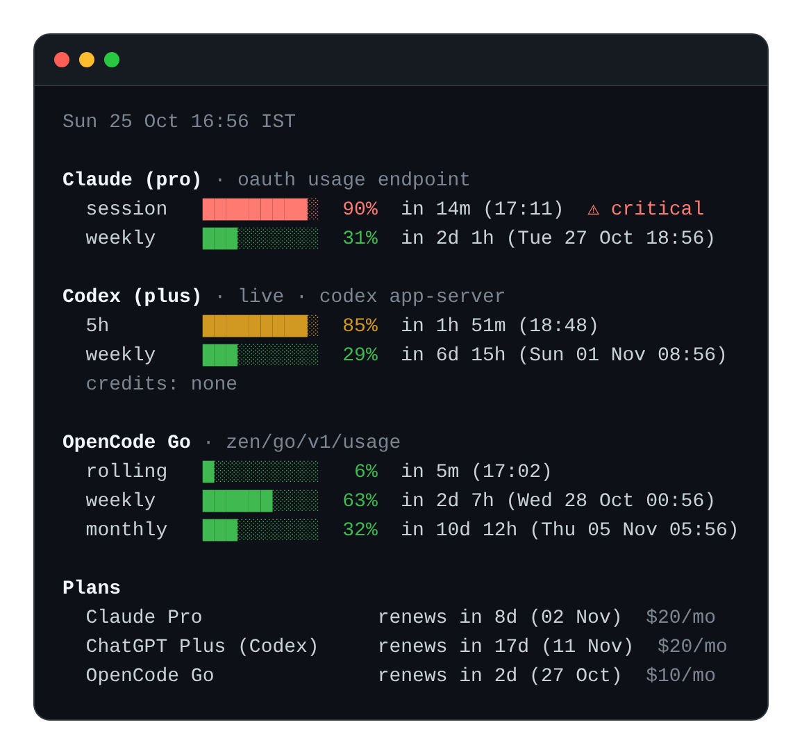

# aiusage

Prints how much of each AI coding subscription is left, and when it resets. Claude Code, Codex and OpenCode Go on one screen.



*Example output. Times follow the timezone in your config.*

I got tired of checking three dashboards before starting a long agent run, so this reads the same local credentials and endpoints the CLIs use and puts the result in one place.

## Commands

| command | output |
|---|---|
| `aiusage` | all three providers, pretty |
| `aiusage claude` / `codex` / `opencode` | one provider |
| `aiusage plans` | renewal countdowns only |
| `aiusage --json` | machine readable, includes the `timezone` in use, exit 1 if any provider errored |
| `aiusage -v` | extras plus the `ccusage` token and cost table |
| `aiusage tz` | show the current timezone |
| `aiusage tz Asia/Kolkata` | set it, once |

Colours switch off when the output is piped; `--color` forces them on, `--no-color` or `NO_COLOR` turns them off.

## Timezones

Every time printed is in one zone: the one in your config, or UTC if you never set one. No dual clocks to read around.

```sh
aiusage tz                  # what is set now
aiusage tz Asia/Kolkata     # set it, once
```

It takes an IANA timezone name: `Asia/Kolkata`, `Europe/Berlin`, `America/New_York`. Lowercase is fine, and `aiusage tz utc` goes back to the default.

Not sure which name is yours? Search online for your city plus "IANA timezone", or look at the tz database list, which has the exact name for every zone. Google usually answers with a plain label like "Indian Standard Time", which is not the name this needs. If you pass one that is not a zone name, you are told so, not silently given a different zone.

The value lands in `~/.config/aiusage/config.toml` as `timezone = "..."` and is used from then on.

## Where the numbers come from

| provider | source | freshness |
|---|---|---|
| Claude Code | `~/.claude/.credentials.json`, then `api.anthropic.com/api/oauth/usage` (the same data as `/usage`) | live |
| Codex | `codex app-server` JSON-RPC `account/rateLimits/read`, falling back to the newest `rate_limits` snapshot in `$CODEX_HOME/sessions` | live, about 2s |
| OpenCode Go | key from `~/.local/share/opencode/opencode.db`, then `opencode.ai/zen/go/v1/usage` | live |

Nothing is uploaded anywhere. The only network calls are to those provider endpoints, with the credentials already on the machine.

## Install

Needs Python 3.11 or newer (for `tomllib`), and any of the CLIs you want a section for must be logged in.

```sh
git clone https://github.com/Ranjit2111/aiusage.git ~/repos/aiusage
chmod +x ~/repos/aiusage/aiusage
mkdir -p ~/.local/bin ~/.config/aiusage
ln -sf ~/repos/aiusage/aiusage ~/.local/bin/aiusage
aiusage tz Asia/Kolkata                                # optional, UTC by default
```

`~/.local/bin` has to be on `PATH`. `git pull` updates in place, the symlink keeps working.

## Tests

```sh
python3 tests/test_parsers.py
```

The parsers and the timezone config are the parts that break quietly, so those are what the tests cover.

## Caveats

- The Anthropic usage endpoint and the OpenCode usage endpoint are undocumented. They are the ones the CLIs and console call, so they can change without notice. When one does, only that section errors out and the rest still print.
- Claude access tokens expire hourly. aiusage refreshes the token itself and writes the rotated credentials back to `~/.claude/.credentials.json`, the same file Claude Code uses, so both stay valid. If a refresh is rejected, run `claude` once to log in again.
- `aiusage plans` reads `~/.config/aiusage/config.toml`; `renew_day` is the day of the month the plan renews, and 0 means unset. Copy `config.example.toml` there to start.
- The OpenCode section reports the Go plan of the account logged into the console on that machine.
- Tested on Linux. It relies on the Unix `select` call, which macOS also has.
